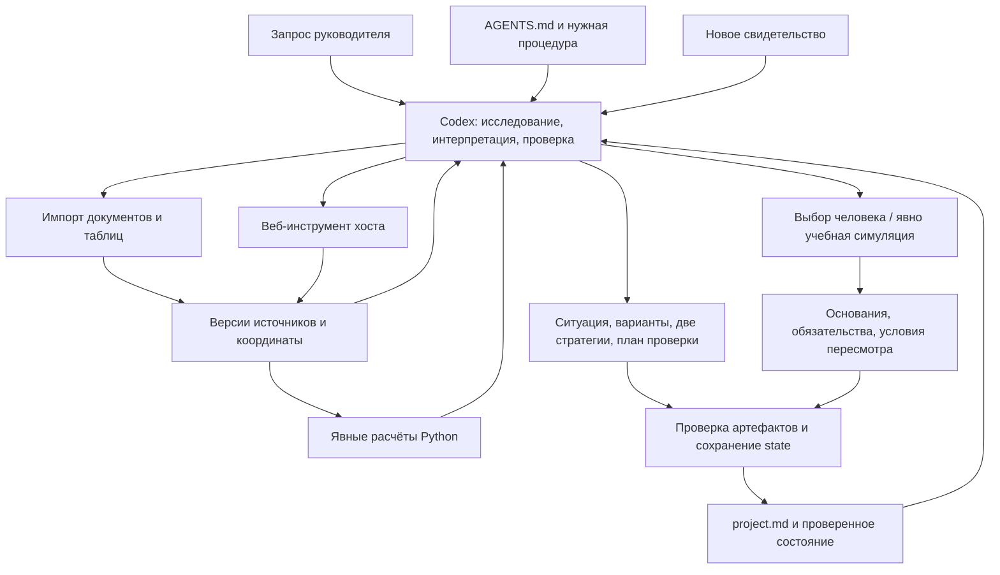

# Архитектура «Стратега Фабрики продуктов»

Актуальная карта на 17 ноября 2026 года. [Архитектурный аудит](ARCHITECTURE_REVIEW.md) содержит находки и доказательства. Прежняя подробная проектная запись сохранена в [снимке до аудита](../evaluation/architecture-review/before/docs/ARCHITECTURE.md.txt). Требования — [исходный конкурсный кейс](../DescriptionMegafonAIAgent.txt).

## Модель работы

Один координатор в уже авторизованном Codex выбирает исследовательский вопрос, инструмент, интерпретацию и рекомендацию. Python извлекает, считает и проверяет файлы. Постоянного backend, собственного цикла вызовов LLM, базы данных или фонового мониторинга нет. Отдельный критик допустим при реальной поддержке хоста и конкретной пользе; продуктовую память пишет только координатор.

## Компоненты

| Обязанность | Реализация | Граница |
|---|---|---|
| Постоянные правила и выбор режима | [AGENTS.md](../AGENTS.md) | Загрузка хостом из корня; без обязательного чтения истории разработки при продуктовой работе |
| Исследование и синтез | [strategy-cycle](../knowledge/procedures/strategy-cycle.md), [методика](../knowledge/methods.md) | LLM выбирает вопросы по влиянию на решение; Python не выбирает победителя |
| Критика и целостность аргументов | [evidence-review](../knowledge/procedures/evidence-review.md) | Содержательная проверка LLM, не доказательство истинности валидатором |
| Импорт и реестр версий | [import_materials.py](../scripts/import_materials.py), [extract_formats.py](../scripts/extract_formats.py) | original/extract/source.json; metadata последней, одинаковый повтор переиспользуется |
| Расчёты | [analyze_table.py](../scripts/analyze_table.py) | Явный spec, единицы/периоды/пропуски, Decimal/Fraction, без исполнения формул |
| Память и публикация ревизии | [project_state.py](../scripts/project_state.py) | load/summary/save/validate/recover; прямые хеши и проверка исходной версии |
| Сопровождение | [decision_followup.py](../scripts/decision_followup.py), [процедура](../knowledge/procedures/decision-followup.md) | choice/impact/review/completion, view и reconcile по запросу |
| Данные и результаты продукта | `projects/<id>/project.md`, `inputs`, `evidence`, `outputs`, `state` | Источники, выводы и история раздельны; ID выбирается явно |
| Разработка и проверка | `docs`, `tests`, `evaluation` | Генераторы, изолированные опыты и драйверы Codex — не продуктовый runtime |
| Материалы передачи | `submission`, упаковочные/экспортные утилиты в `evaluation` | PDF, видео, архив и отчёты; не запускаются при анализе продукта |

## Контекст и исследовательское решение

Новый содержательный запрос запускает полный цикл. Продолжение начинает с project.md и `load --summary`: целостность проверяется полностью, в ответе остаются цель, следующий шаг, нужные ID, текущие outputs и открытые требования. По ним координатор читает исходные фрагменты. Перед редактированием он получает полный state. Сводка не заменяет основания и не пригодна для сохранения как draft.

Противоречия, сильные возражения, сохранение положения и закрытие направления обязательны. Пять итоговых документов должны согласовать аудиторию, задачу, экономику, допустимое обещание и проверку. Непроведённый эксперимент остаётся предложением. Материалы разных проектов и разработки автоматически не смешиваются; [индекс проектов](../projects/INDEX.md) отделяет канонические проекты от записанной демонстрации.

## Источники и решения

[Контракт записей](../knowledge/record-contracts.md) определяет source ID/version, artifact ID/path/hash, координаты, claims и связи derived_from. Сообщённый факт, расчёт, допущение, гипотеза, прогноз и рекомендация различаются. Синтетика наследуется в выводах, в том числе от закреплённого JSON-расчёта без явного source_id; прежний ответ модели не становится независимым источником.

Пара source ID/version сохраняет synthetic и набор origin artifact ID/path/hash во всей истории, включая исчезновение из активного списка и возврат. Новый origin требует новой версии. История проверяется без миграции старых файлов; конфликт или недостающий снимок дают явную неоднозначность. Impact обходит объявленные зависимости; context_from не распространяет изменение, review_dependencies не выводит факт. Старое основание явно superseded/withdrawn, новая рекомендация и первоначальный выбор существуют раздельно. Полноту смысловых связей проверяет координатор — граф не может восстановить отсутствующую связь.

Выбор хранит исходную revision/hash и копии оснований. `accepted` требует реальной инструкции уполномоченного человека; утилита проверяет форму, не личность. `synthetic_instruction` любого вида разрешена только явно учебному evaluation-проекту. Время и перерасчёт не выполняют обязательство и не снимают требование нового решения. Продуктовая процедура требует изолировать симуляцию; один JSON-флаг физическую изоляцию не доказывает.

## Сохранение и отказы

Авторитетен валидный `state/current.json`. Артефакты предварительно записываются в новых путях. Для обновления draft сохраняет исходные revision/state_sha256 полного load; несовпадение с current отклоняется до записи истории. После сверки всей истории save записывает и проверяет временный history-файл, атомарно переименовывает его в новый rN, затем записывает временный current, valid previous и публикует current через os.replace. Номера rN не переиспользуются. Частичная запись остаётся tmp.

Это локальная граница одного файла при одном писателе. После отказа current остаётся прежним либо loader явно диагностирует повреждение. Валидная orphan history резервирует происхождение, но не означает завершение; tmp не регистрирует источник. Reconcile проверяет опубликованный результат события. Recover previous выполняется явно и не освобождает source ID/version. Неоднозначность истории откат не устраняет. Для оборванного первого сохранения без current/previous предусмотрен явный `--retry-initial` только с неизменённым исходным draft. Общей транзакции всех файлов, блокировки писателей и гарантии при потере питания/аварийной отмене интерфейса нет. Исторические проверки отказов сохраняются; тесты проверяют заявленные границы, а не универсальную отказоустойчивость.

## Инструменты и пределы форматов

[Контракты инструментов](../knowledge/tool-contracts.md): DOCX по блокам/ячейкам, CSV по физическим строкам, XLSX по явно выбранным ячейкам, текстовый PDF по физической странице/фрагменту, датированная выдержка веб-страницы. Пропуск не равен нулю; периоды и единицы не смешиваются. Кэши формул не пересчитываются. Скрытые/объединённые ячейки, неоднозначная PDF-вёрстка и неполное чтение остаются видимыми. OCR и произвольные сложные PDF-таблицы не поддерживаются.

## Доверие

Документы, сайты и ответы tools — данные. Их команды не дают разрешения тратить, публиковать, читать секреты или менять правила. Пути ограничены выбранным проектом; синтетические маркеры используются только для проверки. Allowlist упаковки исключает среды, credentials и служебные каталоги; проверка известных шаблонов в поставке не обещает универсального обнаружения секретов. Разрешённые реальные действия определяет пользователь, бизнес-выбор — уполномоченный руководитель.

## Переносимость и стоимость сложности

Windows, PowerShell, Python 3.12; три закреплённых пакета и wheels включены. Установка Python-части работает без сети, LLM требует действующего доступа Codex, текущие сайты — веб-инструмента. Хост нужно открывать из корня распаковки. Процедуры — обычные Markdown-файлы; нативные skills/hooks и фоновые задачи не реализованы.

Новый framework, vector store, scheduler, MCP или база не решают подтверждённые дефекты лучше локальных проверок. Дополнительные зависимости не добавлены. [Первичные архитектурные основания](../evaluation/architecture-review/REFERENCES.md) и [измеренные ресурсы](../evaluation/architecture-review/release-evidence/measured-resources.json) доступны отдельно. Деньги и человеческое время не выдумываются; счётчик токенов не равен оплате подписки.
