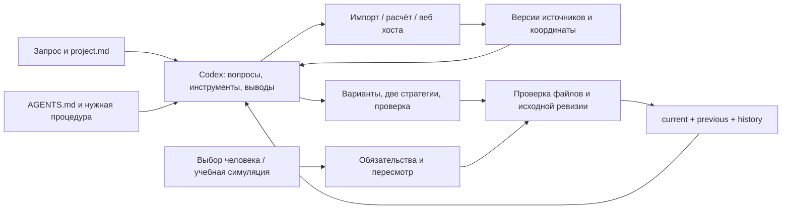

# Проверка архитектуры и готовности к публикации

17 ноября 2026 года. **Репозиторная архитектура соответствует назначению; найденные существенные дефекты исправлены.** После исправления происхождения между несмежными ревизиями локальная регрессия: 100 успешных тестов. Точная проверка новой поставки после распаковки находится рядом с её архивом в «Проверка.md» и «Проверки/FINAL_STATUS.json». Публикация, доступ жюри и конкурсная отправка — отдельные невыполненные действия. Соответствие непрочитанному дополнительному брифу не установлено.

## Что реализовано

Это папка агента для установленного Codex: LLM самостоятельно выбирает следующий исследовательский вопрос, инструмент, интерпретацию и рекомендацию. Python извлекает, считает и проверяет. Один координатор пишет память проекта. Процедуры загружаются явно; собственного backend, нативных проектных skills/hooks, фонового наблюдения или отдельной оркестрации моделей нет.

Фактическая карта файлов и границ — [ARCHITECTURE.md](ARCHITECTURE.md#layout). Постоянные правила, методы, материалы проекта, производные выводы и текущее состояние разделены. Разработческие генераторы, драйверы Codex, запись видео и экспорт PDF находятся в evaluation/submission; это средства проверки и поставки, не продуктовый runtime.

## Находки и исправления

| Находка, важность и область | Конкретное доказательство и последствие | Минимальное исправление; проверка |
|---|---|---|
| Устаревший черновик, высокая; память проекта | До исправления save удалял revision/hash. Черновик r1 после r2 сохранялся как r3 и вытеснял выполненный шаг из current, хотя история r2 оставалась | Каждый update требует revision/hash текущей базы; отказ до history/tmp/previous, подсказка перечитать и согласовать. Тесты stale/missing base/hash mismatch, отказ CLI без отката и успешное осознанное продолжение |
| Потеря синтетического происхождения, высокая; достоверность | Импорт synthetic=true мог быть объявлен source/claim synthetic=false. Расчёт без source_id также терял происхождение | Наследование от закреплённого JSON, запрет противоречащего source flag и переназначения сохранённой source ID/version. Тесты реального importer, расчёта без source_id и изменения привязок |
| Повторное использование исчезнувшей source ID/version, высокая; происхождение доказательств | Изолированная последовательность r1 S/v1 true/A1 → r2 S/v2 true/A2 → r3 S/v1 false/A3 проходила старый guard при полном load, decision format=2, без evaluation и с сохранением всех файлов | Сверка точных привязок и synthetic всей истории; повтор старой пары только без изменения, новый origin — новая version. Полный rN резервирует identity, но не доказывает завершение. Семь целевых тестов: конфликт, reuse, новые версии, отсутствие мутаций, legacy, восстановление, первый retry |
| Учебное завершение вне симуляции, высокая; статус обязательства | synthetic_instruction completion делало обязательство completed в проекте без evaluation | Общая проверка всех четырёх видов события при регистрации и при проверке прямого draft. Два теста обходов, неизменность прежнего current; 23 теста сопровождения успешны |
| Избыточный контекст, улучшение; продолжение | Полный ответ load последнего проекта — 158 636 UTF-8 байт | `load --summary` после полной валидации: 6 557 байт, сокращение 95,87%. Ссылки на текущие outputs, открытые вопросы и требования решения сохраняются; перед редактированием нужен полный state. Тест обнаруживает повреждение непоказанного источника |
| Неоднозначная ссылка PDF, средняя; переносимость | На странице 5 архивного PDF путь к видео записан UTF-8 без BOM: pypdf читает искажённый путь, PyMuPDF — корректный | Экспортёр записывает корректную Unicode-строку Filespec. Независимые парсеры и сравнение всех пяти отрисованных страниц проверяют результат; содержание видео не менялось |
| Устаревшая архитектурная карта, улучшение; сопровождение | Основной документ начинался со среза до нынешнего сопровождения и содержал уже выполненные планы | Карта сокращена до фактических обязанностей; старый текст сохранён. Обновлены контракт save, процедуры, индекс проектов и граница применения прежней записи |

Исправление несмежных версий: [воспроизведение](../evaluation/provenance-release/reproduction.json), [скан 32 историй](../evaluation/provenance-release/history-audit-before.json), [новое независимое ревью](../evaluation/provenance-release/REVIEW.md). Конфликтов в прежних историях не найдено; два старых намеренно оборванных rN сохранены как диагностика. Новый rN появляется атомарно из проверенного tmp; поэтому поддерживаемый обрыв записи не создаёт нечитаемую history. Повреждённый или отсутствующий старый rN явно блокирует load/save, откат previous этого не устраняет. Нужна проверенная резервная копия, а не удаление препятствия. Миграции и новых зависимостей нет.

Воспроизведения до ремонта и независимая автоматическая рецензия: [код и результаты](../evaluation/architecture-review/reviewer/REVIEW.md). Это искусственные диагностические проекты, включая проверку формы подтверждения человека; они не являются бизнес-одобрениями. Правку сопровождения написал отдельный рецензент и прочитал координатор; правки сохранения/происхождения и summary проверил отдельный контекст. Это автоматическое инженерное ревью, не человеческая приёмка.

[Исходные версии изменённых файлов](../evaluation/architecture-review/before-manifest-final.json), [локальная регрессия](../evaluation/architecture-review/observations/regression-local/stderr.txt), [границы восстановления](../evaluation/architecture-review/observations/recovery-tests/stderr.txt), [измерение контекста](../evaluation/architecture-review/context-size.json). Предыдущий аудит добавил восемь тестов, нынешнее исправление — семь содержательных проверок; количество тестов само по себе не является оценкой качества.

## Четыре пути работы и область доказательств

1. **Запрос → исследование → стратегия.** demo-001 разбирает удержание и состав когорт; demo-002 — выбор задачи, аудитории и предложения B2B. Последняя демонстрация добавляет официальные альтернативы и сопровождение. Проверены source/version/locator, независимая арифметика D28 52→24%, оплаты 2/8 и 1/10, различие интереса и оплаты. Сохранение положения, закрытие и два разных вмешательства имеют сильные возражения. Аудитория, функции, сообщение и эксперимент согласованы. [Содержательная рецензия](../evaluation/architecture-review/product-review/REVIEW.md).
2. **Подлинная пауза → независимый Codex → новая ревизия → отдельное чтение.** В прежнем ZIP подтверждены новый thread, исходная r1 до синтеза, собственные анализ/расчёты и r2, затем отдельный успешный loader. Проектные инструкции легитимно присутствовали. Поздний usageLimitExceeded прервал следующий этап; координатор завершил стратегии. Он не отменяет уже сохранённую r2 и не доказывает автономного завершения всего цикла. [Прямой разбор записей](../evaluation/architecture-review/release-evidence/README.md).
   **Новое подтверждение на текущем коде:** отдельный Codex без прежнего transcript выполнил анализ r1→r2, создал полезную заметку и сохранил исходную базу draft. Затем отдельный процесс проверил state, новые артефакты и историю. [Разбор и границы](../evaluation/provenance-release/CONTINUATION.md). Это один шаг, не новый полный цикл.
3. **Учебный выбор → обязательства → существенное основание → пересмотр.** В r7 закреплён вымышленный выбор на базе r6. Новое допущение поддержки 30→90 минут уменьшает вклад 2100→1500 ₽ и остаток при 20 организациях до нуля до неизвестных расходов. r9 сохраняет исходное решение, воронку и проектные пороги; предлагает паузу допуска, полный бюджет и новый выбор. Обязательства pending/blocked, owner review требуется. Это сценарный расчёт, не рынок, не реальный пилот и не одобрение.
4. **Отказ/повтор → восстановление.** Проверяются отказ до сохранения, частичная history, ошибки замены previous/current, потерянное evidence, повреждённый current и повтор события. Current либо остаётся валидным, либо выдаётся явная диагностика; orphan не объявляется завершённым. Идентичное событие не создаёт обязательства повторно, иной payload с тем же ID отклоняется. Новая проверка stale закрывает потерю работы при последовательном обновлении.

Новый продуктовый сценарий не запускался: существующие примеры уже различаются по вопросу решения, данным, вмешательствам и эффекту коррекции. Это ограниченное свидетельство применимости за пределами одного примера, не универсальная гарантия стратегии. Пороговый дизайн текущего эксперимента не заменён историческими числами.

## Версии, даты и комплект

Прежний архив самостоятельно прочитан как ZIP: 192 671 360 байт, SHA-256 `ec83b1b852ad15ff8947572760ff00d25940403703cad6d093ab281e09121c31`; CRC, размеры и все 4381 записи реестра совпали. Его исполняемые файлы и инструкции совпадали с исходным workspace до ремонта. 85 тестов, установка без сети и отдельный reload подтверждены исходными журналами именно этой версии. Неудача прикрепления файла в интерфейсе к целостности локального ZIP отношения не имеет.

Разбор JSON/JSONL внутри прежнего архива не подтвердил события сохранения 17 ноября UTC: все r1–r9 и действия записаны 16 ноября. 148 найденных значений 17 ноября — будущие `due_at` старых учебных обязательств, с `+03:00`. Финальная проверка 16 ноября 18:00 UTC соответствует 21:00 МСК. [Координаты](../evaluation/architecture-review/release-evidence/chronology-17.json). Старые даты и доступ к источникам не исправлялись; новая поставка имеет дату нового аудита.

Текущий комплект — `dist/Материалы-2026-11-17-2/`. Прежние `dist/Материалы-2026-11-16/` и `dist/Материалы-2026-11-17/` сохранены целиком. Второй из них отдельно проходил 93 теста; нынешняя проверка относится к новому ZIP. В новой поставке исполняемые файлы и эффективные инструкции идентифицируются по MANIFEST и отдельному результату свежей проверки. Исторические workspace сохраняют прежний код; это записи опытов, запуск текущего продукта идёт из корня. Видео 451,9 с сохраняет прежние байты и границу авторства. PDF остаётся пятистраничным; исправлены только аннотации локальных ссылок, все страницы совпадают по рендеру. Отдельный PDF рассчитан на соседнюю папку «Проект»; окончательная проверка ссылок выполняется именно в этой раскладке.

Окончательный результат распаковки, установки без сети, pip check, 100 тестов, загрузки состояний и ссылок помещается **снаружи ZIP** рядом с ним. Он содержит хеш точного архива и не пытается хешировать сам себя. [Прежняя сверка](../evaluation/architecture-review/release-evidence/baseline-inspection.json) не подменяет новую. Для передачи жюри используется весь новый комплект, а не отдельный PDF без папки целей.

## Принятые границы и ресурсы

- Один писатель, файловая публикация current через os.replace; нет универсальной гарантии при потере питания или аварийной отмене UI, многописательности и однократности внешних действий. Нормальная просьба остановиться означает сохранение на безопасной границе.
- Валидатор проверяет структуру/хеши/объявленные связи, но не истинность цитаты, полноту смыслового графа или полномочия человека. Эти проверки остаются обязанностью координатора и владельца решения. Команды из источников остаются данными.
- Форматные границы явны: пропуски, единицы и периоды, кэш формул неизвестной свежести, ограничения PDF и неуспешное чтение сайта не скрываются. Нет OCR, фонового мониторинга и автономных сообщений.
- Поставка исключает служебные конфигурации и среды по allowlist. Проверяются известные формы ключей внутри поставки, без поиска секретов пользователя. Это ограниченная проверка, не универсальное доказательство отсутствия любых персональных данных. Содержательные источники — открытые справки и отмеченные учебные материалы.
- [Сводные измерения](../evaluation/provenance-release/RESOURCES.md), [исторические счётчики](../evaluation/architecture-review/release-evidence/measured-resources.json): успешное продолжение 618,953 с, input 1 292 567, cached внутри input 1 229 312, output 23 281, reasoning внутри output 4 825. Поздний synthesis — 1396,812 с до ошибки, итоговый usage отсутствует. Накопительные A/B записаны отдельно; перекрывающиеся интервалы не суммированы. Фактические списания, полное время разработки и активное время человека неизвестны. Применимая ставка и точный серверный вариант не установлены; API-эквивалент не выдуман, платные вызовы ради него не нужны.
- Обычный чат: прежние результаты равны, новое сравнение неполно; превосходство не доказано. Дополнительный бриф не прочитан; учебный пример не является одобренной организаторами заменой. Эти границы не блокируют архитектурный аудит.

[Доступ к официальному кейсу и GitHub](../evaluation/provenance-release/OFFICIAL_ACCESS.md), [конкретная передача на публикацию](../submission/PUBLICATION_HANDOFF.md). Публичный регламент прочитан; содержимое закрытого дополнения не предполагается.

Первичные принципы, применённые к наблюдаемым проблемам, перечислены в [кратком реестре источников](../evaluation/architecture-review/REFERENCES.md). Шесть локальных guidance-файлов не найдены; их чтение не заявлено. Новый framework, сервис или база не добавлены: полезный эффект получен исправлением контрактов и сокращением выдаваемого контекста.

**Технический вывод:** локальный кандидат пригоден для публикации с указанными границами после успешной проверки его точного архива. Реальная публикация, проверка доступа получателя и конкурсная форма остаются отдельными действиями; полная конкурсная готовность по непрочитанному дополнительному брифу не заявляется.
