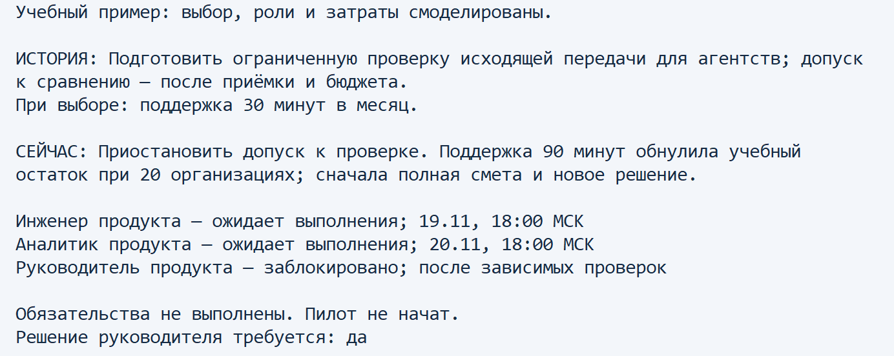
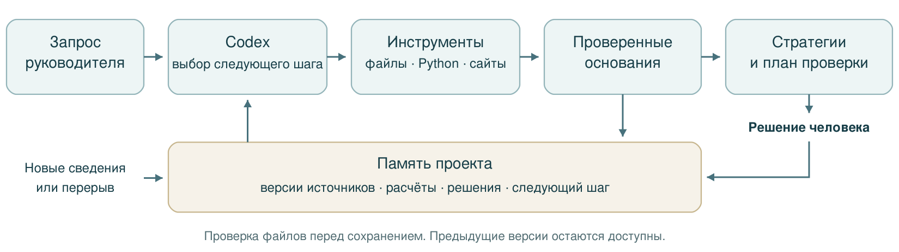
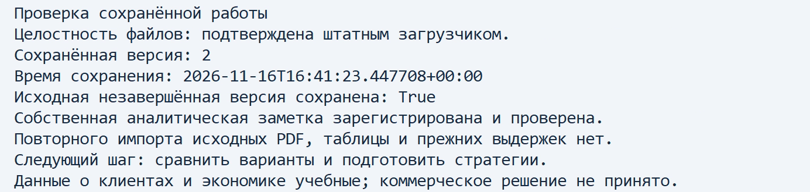

# Стратег Фабрики продуктов

Руководителю продукта нужен обоснованный следующий шаг: для кого развивать продукт, что обещать и когда остановиться. Агент превращает документы, таблицы и открытые источники в варианты решения, согласованные продуктовую и коммуникационную стратегии. После выбора сохраняет основания, ответственных и условия пересмотра. Бизнес-решение остаётся за человеком.

**Демонстрация на самостоятельном учебном примере. Данные о клиентах и затратах смоделированы; сведения об альтернативах взяты из официальных источников.** Дополнительный бриф организатора прочитать не удалось; соответствие ему не подтверждено.

## Конкретный запрос и полезное обнаружение

У команды есть прототип RelayBox для передачи файлов. Развивать отправку материалов клиентам агентств, строить сбор документов для бухгалтерских бюро, оставить внутренний инструмент или закрыть направление?

В записке названы восемь «платных пилотов». Агент сверяет вторую физическую страницу PDF и ячейки D3:F4 листа «Воронка»: это **восемь проявлений интереса**, а первая оплата у бюро — одна из десяти проб. У агентств — две из восьми: 25% против 10%. Малые смоделированные группы не доказывают спрос или превосходство сегмента. [Исходники и расчёты](EXAMPLE.md) доступны отдельно.

Прототип описывает исходящую ссылку: до 2 GB на файл, семь дней, без аккаунта получателя, ручной отзыв. Входящего сбора, пароля, именного доступа и аудита нет. Это учебная спецификация; реальная приёмка продукта не проведена.

## Почему официальные источники меняют предложение

Справки прочитаны 16 ноября 2026 года; сохранены даты, координаты, существенные выдержки и ограничения.

| Альтернатива | Что влияет на выбор |
|---|---|
| [Dropbox Transfer](https://help.dropbox.com/share/dropbox-transfer) | В Basic — 2 GB на **всю передачу**, семь дней, без аккаунта получателя. Пароли и собственные сроки зависят от плана. Это не лимит одного файла RelayBox. |
| [Dropbox file requests](https://help.dropbox.com/share/create-file-request) | Готовый входящий сбор без аккаунта отправителя. Basic/Plus/Family — файл до 2 GB; перечисленные расширенные планы — до 250 GB. Для срока приёма действуют отдельные правила. |
| [Яндекс Диск](https://yandex.ru/support/yandex-360/customers/disk/web/ru/share/sharing) | Пароль, срок и запрет скачивания — с тарифом Яндекс 360. Пароль не равен запрету скачивания; возможны ограничения форматов и частых загрузок. Это меняет выбор пригодного контроля. |

Справки подтверждают возможности альтернатив, но не спрос, цену и расходы RelayBox. Поэтому проверять нужно дополнительную пользу в рабочем процессе относительно **лучшего разрешённого способа клиента**, с его реальным тарифом. [Точные границы источников](TECHNICAL_APPENDIX.md) сохранены.

<!-- PAGE -->

## Выбор, стратегия и проверка

Первоначальное предложение — ограниченно проверить исходящую передачу для агентств после приёмки и решения о бюджете. Направление соответствует описанным функциям; подтверждённого платного отличия пока нет.

| Вариант | Условие выбора и сильное возражение |
|---|---|
| Передача агентствам | Проверяемая польза и платежи относительно лучшего контроля. Возражение: готовое облако уже закрывает задачу, помощь команды съедает вклад. |
| Сбор для бухгалтерских бюро | Нужны отдельное основание спроса и смета отсутствующей функции. Интерес не равен оплате; готовый сбор уже существует. |
| Внутренний инструмент / пауза | Нужны внутренний владелец и ценность либо конкретный срок пересмотра. Поддержка и потеря возможности не исчезают. |
| Закрыть направление | Пригодное сравнение не подтверждает платное отличие или полная экономика неприемлема. До исполнения нужно оценить обязательства, стоимость выхода и потерю возможности. |

Продуктовая стратегия: проверить повторяющуюся исходящую задачу, не разрабатывать одновременно сбор и расширенный доступ. После приёмки допустим черновик сообщения: **«Передайте клиенту готовые файлы по ссылке: без аккаунта получателя, до 2 GB на файл, на семь дней, с ручным отзывом»**. Рядом — отсутствующие функции и запрет обещать удаление уже скачанных копий. Экономия времени пока гипотеза. Разговор выявляет задачу, демонстрация проверяет понимание, инструкция помогает пользоваться, прозрачное предложение оплаты проверяет готовность платить; массовая реклама не входит в этап.

План предлагает 12 организаций и четыре задачи каждой за 28 дней: по две каждым способом, порядок случайный. Совместные проектные пороги:

- Не менее 9 из 12 экономят хотя бы пять **клиентских** минут; завершение задач не хуже контроля.
- Ценность до платы за RelayBox не менее 6 000 ₽/месяц у 6 из 12, включая минимум трёх повторных плательщиков. Частота измеряется и у неплательщиков; труд нашей поддержки учитывается отдельно.
- Минимум четыре первые и три повторные оплаты по 3 000 ₽, причём повторы — не менее 60% первых. Нет существенных пропусков и неразобранного вреда.

Первое платёжное окно — семь дней; повтор — через календарный месяц после первой оплаты и ещё семь дней. Нужно дождаться окон **всех** впервые оплативших. Пороги предложены для согласования, не получены из результатов или расчёта статистической мощности. Масштаб требует отдельного решения, минимум трёх предлагаемых оплачиваемых периодов и полной экономики.

Если пригодное сравнение не проходит совместные пороги пользы, ценности, первых или повторных оплат — предложить закрыть проверяемое платное направление. Неполные данные означают ограниченную паузу, а не успех или автоматический переход к бухгалтериям. [Полные стратегии и план](EXAMPLE.md).

<!-- PAGE -->

## Жизнь после решения

В изолированном примере записан **симулированный выбор вымышленного руководителя**: подготовить проверку агентского предложения. Инженеру — протокол приёмки к 19 ноября, 18:00 Москвы; аналитику — полный бюджет к 20 ноября, 18:00. Допуск руководителя зависит от обоих оснований. Реальные контакты, расходы и пилот не разрешены.

После выбора введено новое учебное допущение: поддержка растёт с 30 до 90 минут на организацию в месяц. Цена — 3 000 ₽, инфраструктура — 600 ₽, час помощи — 600 ₽:

**3 000 − 600 − 30 × 600 / 60 = 2 100 ₽ → 3 000 − 600 − 90 × 600 / 60 = 1 500 ₽.**

При двадцати организациях и фиксированных 30 000 ₽/месяц остаток падает **с 12 000 ₽ до нуля**. Положительный остаток начинается с 21 организации вместо 15, ещё до неизвестных привлечения, налогов и продлений. Подготовка 60 000 ₽ не возвращается при нулевом остатке. Это сценарий, не прогноз или прибыль.

*Кадр реального проектного окна: исходный выбор сохранён, новое предложение требует решения. Роли, сроки и событие — симуляция; обязательства не выполнены.*

Агент предлагает **приостановить допуск**, проверить происхождение 90 минут и полную смету к указанному сроку. Если приемлемой экономики и конкретного дешёвого исправления нет — предложить закрытие после оценки выхода. Воронка, официальные факты и пороги проверки использованы повторно. Изменена одна ячейка, пересчитана её экономическая цепочка; история не переписана. [Записи и проверка изменения](TECHNICAL_APPENDIX.md).

<!-- PAGE -->

## Как агент работает и помнит задачу

Codex анализирует основания и выбирает следующий полезный шаг. Python извлекает данные, считает и проверяет файлы. Память хранит источники, координаты, версии, выполненное, открытые вопросы и следующий шаг. Общую память пишет один координатор; прежний текст агента не становится независимым подтверждением.

**Продолжение текущего кода в новом чате проверено.** Новый чат — отдельная беседа без старой переписки. Ей передали подлинную незавершённую папку проекта и короткий запрос. Codex сам разобрал противоречие между интересом и оплатой, создал аналитическую заметку и сохранил новую версию. Другой процесс загрузил результат и сверил файлы. Проверен один полезный шаг; весь цикл стратегий заново не выполнялся. [Результат текущей проверки](CONTINUATION.md).

*Кадр относится к продолжению 16 ноября. Более новая проверка текущей реализации проведена 17 ноября и описана отдельно. Скриншот не выдаётся за её запись.*

Ключевые правила, **в объяснительном изложении**: Python извлекает, считает и проверяет; материалы источников не дают агенту команд; сначала записываются и проверяются результаты, затем обновляется память проекта. [Точные инструкции](../AGENTS.md) сохранены без изменения. Запросы: «Помоги выбрать аудиторию и предложение»; «Продолжи анализ проекта по сохранённым файлам». [Полные исходные запросы](TECHNICAL_APPENDIX.md).

Дополнительно реализованы проверка арифметики, обнаружение повреждений, история выбора, обязательства и точечный пересмотр зависимых выводов. Незатронутое повторно используется. Проверки выполняются при обращении; фоновых напоминаний нет.

<!-- PAGE -->

## Средства, наблюдения и запуск

| Средства | Назначение |
|---|---|
| Codex; независимые исследователь и рецензент | Анализ, источники, критика. В исторических командных сессиях настроена gpt-6-astra; точный серверный вариант и модель основного чата не установлены. |
| Codex CLI 0.169.0-alpha.11.1; app-server; PowerShell | Запуск из командной строки; программное подключение к Codex; оболочка команд. Независимые сессии и диагностика. |
| Python 3.12.10; openpyxl 3.1.5; pypdf 7.1.0; et-xmlfile 2.0.0 | Чтение таблиц/PDF, точные расчёты Decimal/Fraction, сохранение версий и проверки. |
| Веб-инструмент; справки Dropbox и Яндекса; UCI | Публичные сведения об альтернативах и описание независимого набора данных. |
| PyQt5 5.15.11 / Qt 5.15.2; FFmpeg и ffprobe 8.0 | Настоящее окно команд; запись, монтаж и проверка видео. |
| Markdown 3.9; PyMuPDF 1.26.3; Pillow 11.3.0; файловые средства, часы и просмотр изображений | Создание и осмотр PDF/кадров, упаковка, измерения. |
| Node.js 22.20.0; curl 8.22.0; Git; проверка документных сессий | Временный клиент Codex; проверка адресов; разрешённая публикация. Подключённой сессии конкурсного кабинета нет. |

Историческое продолжение 16 ноября заняло 10 минут 19 секунд. Следующий этап длился 23 минуты 17 секунд и остановился на лимите сервиса до сохранения стратегий. Координатор демонстрации проверил подготовленное, исправил критерий первых оплат, сохранил стратегии и провёл учебный пересмотр. В новом продолжении 17 ноября проверен только один аналитический шаг.

В истории были ошибки авторизации среды, запуска окна Tk и отсутствия pypdf в дополнительной сессии; использованы разрешённый доступ и установленные альтернативы. Владелец задавал задачу и разрешил симуляцию; внешней помощи организаторов не было. [Ошибки, помощь человека, время и счётчики](TECHNICAL_APPENDIX.md) раскрыты отдельно. Реальные списания, полное время разработки и активное время человека неизвестны; стоимость не названа нулевой.

Преимущество перед обычным чатом не установлено: прежнее сравнение дало одинаково адекватные ответы, а новое не завершилось из-за лимита. Отдельная проверка UCI подтвердила полный импорт 12 330 строк и арифметику 23 групп; причинный эффект и спрос RelayBox из неё не следуют. [Результат и ограничения](INDEPENDENT_DATA.md).

Для запуска скачайте репозиторий или распакуйте архив, создайте среду Python 3.12, установите три вложенных пакета без сети и откройте папку в авторизованном Codex. Новые API-ключи не нужны, доступный лимит аккаунта нужен. [Инструкция](../README.md).

Нет распознавания сканов, гарантии сложной PDF-вёрстки, одновременных писателей и сохранения при аварийном закрытии. Рыночного эксперимента не было. [Историческое видео](video/Демонстрация.mp4) сохранено. Commit и push разрешены; предоставление жюри доступа к закрытому репозиторию, загрузка видео на площадку и конкурсная отправка остаются отдельными действиями.
